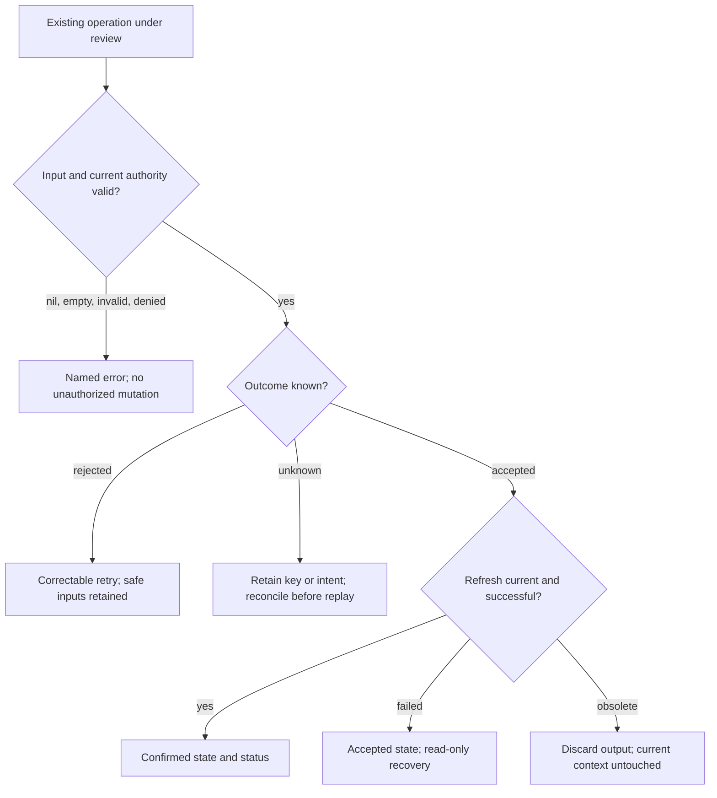

# PR56 round 2: test and evidence plan

Generated 2026-10-27 by the sequential Engineering plan review, after CEO and Design. Target baseline `11fab4f675883050c59a69d0ffde567e1006d195`; final head/tree are not yet known. This is a proposed verification contract, not an assertion these tests ran. The reviewer executed the existing root saved-component reproduction once and observed its expected failure; no JSX/browser/database test ran here.

## Affected journeys and routes

| Lane | Existing route families | What to verify and why | Planned new owned regression files |
| --- | --- | --- | --- |
| Identity/inquiries | `/login`, account/settings, `/workspace`, client requests, private inquiry outcomes | Same person/record through sign-in, edit, submit, export, deletion and outcome transitions; no stale authority | `tests/round2-identity.test.mjs`, `tests/browser/round2-identity.spec.ts`, `Round2IdentityInquiryIntegrationTest.java` |
| Marketplace | `/components`, component details, `/saved/components`, `/templates`, `/college-projects`, workspace publishing/source/slots | Immutable rights/version/access, private saves, source withdrawal and continued catalogues | `round2-marketplace.test.mjs`, `browser/round2-marketplace.spec.ts`, `Round2MarketplaceIntegrationTest.java` |
| Runtime/storage | Existing lab/hosting workspaces and proof editor | Admission, expiry/cancel/crash, intent/PUT/complete, abandoned storage and cleanup | `round2-runtime.test.mjs`, `browser/round2-runtime.spec.ts`, `Round2RuntimeStorageIntegrationTest.java` |
| Finance | Existing delivery/maintenance workspaces and operator views | Consented frozen terms; order/reconcile/refund/dispute/invoice/entitlement transitions | `round2-finance.test.mjs`, `browser/round2-finance.spec.ts`, `Round2FinanceIntegrationTest.java` |
| Operations | Existing team/business/trust/moderation/admin/operations views | Membership/manager changes; queues, pagination, search/projection and privacy handoffs | `round2-operations.test.mjs`, `browser/round2-operations.spec.ts`, `Round2OperationsIntegrationTest.java` |
| UI/performance | Shared fields/dialogs, account/forms and impacted real rows/cards | 320px, 200% text, focus/keyboard/status/disabled and intentional motion | `round2-ui.test.mjs`, `browser/round2-ui.spec.ts` |
| Root | Same-origin proxy, shared errors/security/config/DTOs/grants, final CI | Preserve response/security and exact-head provenance across lane changes | Existing focused tests or root-reviewed ownership amendment |

Use actual discovered route paths from the component's navigation before implementing a test; route families above are scope, not invented endpoints. Existing login/preview/catalogue behavior supplies positive controls. A route-mocked test proves frontend behavior only; integrated authority and database invariants need MockMvc/PostgreSQL or connected journeys.

## Required finding record and branch coverage

For each confirmed finding record ID, exact source/lines, observed expected vs actual behavior, minimal reproduction, affected actor/resource/generation, reads/writes, authority check, persisted effects, expected retry, changed branches, positive/negative controls and evidence limitation. Hypotheses not confirmed are retained with the falsifying source/test. The root's sitemap-pagination hypothesis was rejected because `shared/Pages.query` returns `totalPages`; do not turn it into a 200-request bug claim. A defect list is neither a quota nor a claim that unknown defects are absent.



This diagram describes operation classes, not a new state-machine implementation. Every changed condition/early return/catch must be added to its finding's concrete table. Domain owners trace direct helper callers too; root owns any shared helper edit. No new endpoint, background job, external provider or prompt integration is preapproved.

| Branch / interaction | Existing evidence read | Required new/focused test when changed | Positive and negative controls | Layer / gap |
| --- | --- | --- | --- | --- |
| Missing/empty/type/length input | Java `Errors` named handlers; DTO/domain validation | Null/missing, empty, boundary maximum and maximum+1, invalid enum/encoding where accepted by route | Valid write succeeds; invalid write changes no persisted fact | Unit/helper + HTTP/PG; per-finding map pending |
| Actor or selected ID changes during read | Prior profile/team/publishing regressions | Hold old response, switch actor/record/filter, release old response in both orders | Same-context response applies; stale error/success cannot change current state | Real component + PG denied access |
| Same-resource duplicate submit | Prior `inFlight` guards, payment reservations | Two rapid calls and concurrent server attempts | One effect; legitimate later new operation succeeds | Helper/component + transactional PG |
| Mutation rejects definitively | Existing 409/validation recovery specs | Trigger actual rejection, retain editable input/file/selection, retry corrected value | No success text; corrected request succeeds once | Browser + persisted-state integration |
| Server accepts, response lost | Shared `api()` invalid-success contract; committed payment reservation | Provider/server applied mutation then network failure/malformed success | Same key/intent retained; reconcile or refresh; no duplicate effect | Browser request counts + PG/provider fixture |
| Mutation accepted, refresh fails | Profile/proof/template prior tests | First write succeeds, following read fails then read retry succeeds | Exactly one write; current draft safe; no false terminal success | Executable routine + browser |
| Authority revoked during write/provider I/O | `PaymentService` re-lock/current authority plus system fact recording | Two actors; revoke membership/session or suspend resource between steps | User effect denied; verified external facts retained; no private projection | Real PG + provider fixture; critical if touched |
| Close/unmount/back while pending | Existing proof close test | Close or replace component, release delayed request/callback | No subsequent PUT/complete/download or state update in new context | Real component; connected if storage contract changed |
| Token/intent replay and expiry | Existing identity/upload/hosting suites | Before/at/after expiry, single-use replay and current resource identity | Valid unexpired intent works; replay cannot create second effect | HTTP/PG/provider protocol |
| Provider event ordering | Existing refund regression | Duplicate, late failure after verified success, mismatched ID/amount/mode, pending then terminal | Verified money/period facts monotone; no unauthorized fresh collection | Real PG and signed local provider fixtures, never LIVE |
| Pagination / queue replacement | Prior continuation tests; `Pages.query` metadata | Empty first/final page; one item; full page; repeated page; filter/permission changes; failed append | Confirmed earlier rows retained, no foreign/duplicate rows; bounded continuation | Component + HTTP/PG |
| Source/catalogue withdrawn or replaced | Existing immutable versions and entitlement tests | Release/approval changes between listing and download/checkout | Current exact approved authorized source succeeds; stale reference denied | HTTP/PG + selected connected path |
| Shared errors and label semantics | `FormErrors`, prior form-layout spec | Error summary focuses and links to valid stable field; labels unchanged by error copy | No-error state remains editable; inaccessible target fails test | Real browser actual component/style |
| Narrow viewport and enlarged text | Existing 18-route 320px matrix; 200% form fixture | Changed component at 320px, existing phone/tablet/desktop, long accepted metadata, text enlarged 200% | Local row/control content and document fit; dialogs scroll and focus reachable | Browser geometry/screenshots; not pure source tests |
| Reduced-motion / visual fallback | DESIGN.md and existing design suites | Changed selectors under normal/reduced motion, forced colors or reduced transparency if relevant | Essential controls visible in both; wanted motion preserved normally | Styled browser; no broad unsolicited redesign |
| Performance / bounds | Existing throttled shell collector; finite provider loop | Same workload before/after, cold/warm clearly separate; raw timings/query count/bytes/heap as appropriate | Equivalent output/authority/errors; no greater memory/request growth | Measured experiment only; no current result |

Coverage cannot honestly be expressed as a percentage of all unknown codepaths. No new implementation exists at this plan stage. Each worker must supply its final changed-branch coverage table; parent verifies all changed true/false, rejection/rescue, stale/current and positive/negative cases before qualifying the final head. Any newly introduced regression must have a critical behavioral regression, not a deferred TODO.

## Concrete first confirmed finding: saved-component selection race

Source: `app/components/component-save-button.tsx:9-10`. Existing load lifetime guards apply only to the read. `toggle` awaits the old slug's request, then unconditionally calls `setSaved(next)`; rerendering with a new slug can therefore reflect the old record's saved result. The root wrote `.unlazy/pr56-round2/repro-saved-component.mjs`, extracting the actual production routine using `stripTypeScriptTypes`; the reviewer reran it and observed `visibleSlug=beta`, `savedAfterOldAcknowledgement=true`, exit 1 with `true !== false`. This is a confirmed async-routine failure, not a React rendering measurement.

Required coverage: same-slug save and remove succeed; switch alpha -> beta while alpha POST/DELETE is pending, resolve success and failure, beta's `aria-pressed`/error/login/busy stay tied to beta; pending fresh beta load disables action until confirmed; preview/connected mode switch resets context; unmount safely; 401/403 show truthful authority state. Test real React rerender and delayed responses in `round2-marketplace.spec.ts`, plus extracted/helper regression locally. Do not invent a login actor prop just to assert it; trace actual session identity and mount ownership. The related SavedComponents denied-removal retention case remains a candidate until independently reproduced; any repair needs 401 and 403 plus 503 retained-list positive control.

## Three adversarial acceptance cases per applicable repair

- **Friday confidence case:** complete the normal user journey and recover after an accepted write's refresh fails; persisted state has one effect and the user can continue.
- **Hostile QA case:** switch actor/record and immediately double-click or replay a stale key/URL; current context and forbidden DB rows remain unchanged.
- **Chaos case:** drop/reorder the response after external/server acceptance, revoke authority in the gap, then retry/reconcile; effects remain monotone and recovery is explicit.

Use deterministic deferred responses, fixed database timestamps or injected clock where available. Avoid arbitrary sleeps, random ordering, real external services, local timezone dependence and test-order-dependent shared fixtures. Assert state before releasing delayed responses so a race cannot pass merely because the action never started. Always include the same-context/no-revocation positive control, or an accidentally disabled feature can appear secure.

## Avoid the previous late fixture failures

| Previous failure | New prevention gate | Where it can actually run |
| --- | --- | --- |
| Invalid edited JSX (`e077807`) | `npx tsc --noEmit`, real production build; do not call strip-types a JSX parser | CI after `npm ci`; no local tsc/esbuild available |
| esbuild plugins with sync API (`e87c216`) | If fixture uses plugins, `await build(...)`; smoke mounts real component; sync only when no plugins | CI new-spec lane |
| Incomplete/ineligible actors (`e87c216`) | Seed all required typed DTO fields and eligibility; assert intended action enabled before test | CI types + fixture smoke + real PG |
| Native required field / OTP geometry (`403d85d`) | Fill actual valid prerequisites; assert submitted request fired; inspect actual native/control bounds | CI browser, current phone/tablet profiles |
| Missing viewport and missing CSS (`f3cda1d`, previous report) | Meta `width=device-width`; real styles; wait fonts; verify CSS control/token before layout assertion | CI browser; never infer from a text fixture |
| Label altered by inline error (`f3cda1d`) | Stable visible labels, separate described-by errors, post-validation `getByLabel` assertion | CI real component |
| Obsolete connected upload success copy (`11fab4f`) | Assert current confirmed state and refreshed editability, not historical wording alone | CI connected path after current build |

Root should add a CI step immediately after Chromium installation:

```bash
npx playwright test tests/browser/round2-*.spec.ts --workers=2 --max-failures=1
```

Then preserve the existing complete `npx playwright test --workers=2 --max-failures=3` step. The first lane intentionally runs the new files twice on a successful build: its value is diagnosing fresh harness/fixture failures before waiting through the large existing suite. Do not use `--pass-with-no-tests`: once the test files exist, non-discovery must fail. No new tests/fixes means root can omit this targeted step rather than add an empty glob. Preserve failure traces/screenshots and the full existing project matrix; do not turn failures into skips or add retries to hide them.

## Commands, execution feasibility and evidence levels

| Layer | Command / check | Local status | What it proves |
| --- | --- | --- | --- |
| Changed mjs parse | `node --check tests/round2-<domain>.test.mjs` | Feasible on Node24 | JavaScript syntax only |
| Actual helper / extracted routine | `node --experimental-strip-types --test tests/round2-<domain>.test.mjs` | Feasible only if its imports need no missing dependency | Named algorithm/async-state behavior; not hooks, DOM, HTTP or SQL |
| TS stripping | `stripTypeScriptTypes` for actual non-JSX source | Feasible | Supported non-JSX transform/parse, not TypeScript semantic typecheck |
| Java grammar | Parent-authored `.unlazy/pr56-round2/CheckJavaSyntax.java`, with positive/negative controls | Feasible on Java17; parent owns execution details | Grammar only, no classpath/type checking, Spring wiring, SQL or tests |
| TSX / module/types | `npx tsc --noEmit` | Unavailable locally | CI actual types/imports/DTO fixture compatibility |
| Production frontend | `npm run build` then frontend security check | Unavailable locally | Actual supported bundle and asset checks |
| New + existing Node | `node --experimental-strip-types --test tests/*.test.mjs` | Full suite unavailable locally | CI full executable contracts; distinguish any source checks |
| New browser fixtures first | Command above after Chromium install | Unavailable locally | Real component/fixture behavior across existing projects |
| Full responsive/browser | Existing full Playwright command | Unavailable locally | Current build app/preview routes and mocked-component cases |
| PostgreSQL integration | Existing Maven verify with guarded `TEST_DB_*` | Maven/PG absent locally | Actual HTTP/service/transactions/permissions against disposable DB |
| Connected stack | Existing docker-startup job and connected config | Docker absent locally | Production frontend + Java/PostgreSQL/SMTP/storage paths |
| Security/privileges/provenance | Existing SAST, source contract, role grants, dependency/container evidence | Selected source checks feasible; full jobs CI | Exact implementation/evidence bindings, not launch certification |

No local dependency installation or platform workaround is proposed by this reviewer. The primary-runtime Playwright package without a browser is not a runnable application browser environment. Missing tools are not passing checks. Parent owns CI and remote observation; worker reports exact commands, exit statuses and limitations without printing ignored environment settings.

## Performance evidence standard

First identify an observed wait, redundant request, large allocation or unbounded scan and the actual user impact. Capture reproducible baseline and repaired workloads with identical data, mode, viewport, throttling, warmup and sample count; record raw samples plus median/tail/noise range and equivalent outputs. Do not call a four-sample browser paint proxy field INP or general p99. If runtime access prevents a comparison, document a source-backed bound or hypothesis and avoid an improvement claim. A new loop cap also needs eventual-drain tests beyond the cap and error/retry tests; faster incomplete processing is not a valid optimization.

## Final qualification and stop rule

1. Workers deliver finding and changed-branch tables, executable regressions, precise local evidence and limitations, with no commit/push and no edits outside ownership.
2. Parent independently reads diffs, verifies reproduction/cause, and reruns focused supported checks. Another independent review covers financial/security changes before push.
3. Root reconciles shared helpers/DTOs/grants/security evidence; every actual new migration has explicit rollout/recovery approval within existing scope before implementation.
4. Root stages only intentional files; unrelated PNG and ignored environment files remain untouched/excluded. Record exact head/tree before pushing the same PR56 branch.
5. Wait for and inspect all eight existing workflow jobs at that final head. New-fixture lane, full Node/types/build/browser/PG/connected/security/restore remain required. Failures are repaired and affected checks rerun; baseline counts are not reused.
6. Save final head/tree/run IDs, actual suite counts, intentional skips, rendered screenshots/metrics, repaired and falsified hypotheses, and remaining production gates in `ROUND2_AUDIT_RESULTS.md`/PR metadata. This is parent-owned work.
7. PR56 remains unmerged. No merge/deployment/activation/real transaction follows from passing this audit.

No LLM/prompt change is proposed, so no LLM quality eval suite applies. Provider fixtures remain deterministic contract tests, not merchant acceptance. A complete successful final current-head workflow ends this bounded work; do not repeat passing checks or add speculative changes after qualification.
