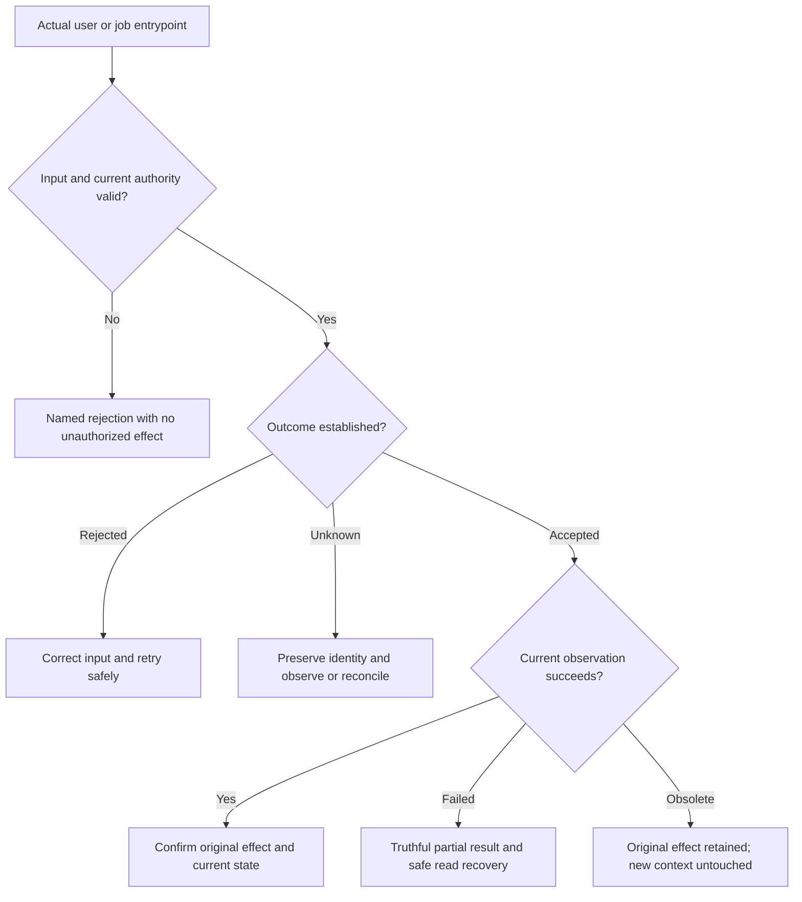

# PR56 Round 3 test plan

Generated by the independent sequential engineering review after CEO and design. Review baseline `08d707d7d82a5f3744000ee7628aa395c6ebd6d1`, tree `71f7d44c01c402257528f861dd3de2636f6a87a8`. Final head/tree, actual fixes and actual test results remain unknown. This document is a proposed verification contract, not evidence of execution. Prior 794 backend / 544 Node / 1042 responsive / 36 connected results apply only to the prior baseline.

## Affected journeys and existing acceptance

Route families below describe current product areas, not newly invented routes. A domain owner must follow the actual component/controller route before implementing its regression. Owned filenames are potential regression locations; no empty test is required where a meaningful alternative or rejected hypothesis is the correct result.

| Owner | Route/journey family | Additional focus | Existing source/test anchors |
| --- | --- | --- | --- |
| Identity 2 | Login/signup, confirmation, account/privacy/profile, client inquiries | Capability expiry/replay, OAuth, closure/export, notifications and inquiry moderation | Security/AuthService; TestDatabaseGuard; existing auth/security/privacy/expiry tests; Round 2 ClientRequests/confirmation controls |
| Marketplace 3 | Components/details/saved, templates/source, college/education publishing | Released vs draft identity, withdrawal/review/appeal/source access, facets, saved metadata work | ComponentService source/history/review; ComponentBookmarkService; existing component/education/commerce integration and browser tests |
| Runtime 4 | Proof editor, uploads, labs/hosting/operator | Admission/leases/fencing, intent completion/replay/expiry, cleanup and job failure/rerun | MediaService expireWrites/removeObjects; jobs/Maintenance; lab/provider suites; Round 2 runtime PG/HTTP controls |
| Finance 5 | Delivery/maintenance participant and operator views | Frozen consent/revision, authority, reservations, refund/dispute/invoice/entitlement evidence | PaymentService/Repository and maintenance suites; V51 holds; existing original signed webhook/reconciliation tests |
| Operations 6 | Teams/business/trust/moderation/admin/analytics/observations | Tenant/role changes, expiry, current public evidence, consent/private handling and pagination | TeamService/Policy, matching/privacy/analytics tests, observation components and prior team acknowledgements |
| UI 7 | Shared controls, header/public navigation, forms/dialogs/preview roles | Native required input, keyboard/focus, error links, download/clipboard failures, back/return, 320px and 200% text | Header, FormErrors, Select/Dialog, real form-control CSS; existing design/layout tests and Round 2 Picker fixtures |
| Root | Shared API/proxy/MoreRecords/DTO/config/grants/migrations/SAST/workflow | Cross-domain contracts, integration, final exact-source provenance | Existing shared response/proxy/security/permission checks; complete CI and artifact binding |

Root's latest PLAN explicitly assigns notifications/** to identity, observation components to operations, and demo-role/review/workspace form helpers to UI. Read-only review may cross lanes; writes require amended matching ownership before editing.

## Finding and regression record

For each proposed repair record: stable finding ID; exact baseline; quoted source/lines and direct callers; actor, authority, resource/tenant and selected revision; expected vs observed behavior; actual before-fix failing command; actual passing positive control; affected reads/writes and persisted facts; minimal repair; every changed guard/condition/early return/catch; safe recovery; post-fix checks; independent review; evidence limits. A preexisting Round 2 failure cannot be recounted as a fresh finding without demonstrating a different still-broken branch.

Each production change needs a meaningful regression that fails against the original code and passes after repair. When local real browser/PG dependencies are unavailable, label those fixtures unexecuted until CI; do not substitute an extracted method's passing result for Spring/JDBC/React behavior. Root independently reruns the supported reproduction and inspects the real-boundary fixture before integration.



This is a test classification, not a preapproved replacement state machine.

| Changed path/branch | Specific negative/edge control | Positive control | Required layer |
| --- | --- | --- | --- |
| Validation | Missing/empty/type/enum/length boundary; invalid required native field sends no request | Valid same actor/DTO sends and commits once | Helper where pure, real browser and HTTP/PG where accepted by route |
| Identity/resource/generation | Hold earlier response; change actor/selection; release success and error in both meaningful orders | Current response applies | Actual React component; PG privacy/authority where changed |
| Definite rejection | Domain 400/401/403/409 with state before/after | Corrected authorized attempt succeeds | Browser feedback + real authoritative state |
| Unknown write | Commit/effect occurs then transport fails/malformed success; no implicit fresh retry | Read/reconcile resolves original identity | Browser request counts plus real provider/PG fixture |
| Accepted write, failed refresh | POST succeeds; following read fails; safe read-only retry | Accepted result reflected after retry with exactly one write | Actual component and appropriate backend state |
| Expiry under lock | Begin valid; hold database lock; expire token/session/membership; resume | Unexpired allowed request succeeds | Real PostgreSQL with bounded latches/timeouts, not only copied Java |
| Role/tenant/resource revalidation | Revoke membership/session/role or alter selected resource between steps | Current allowed actor still succeeds | Real HTTP/PG; post-I/O fixture where applicable |
| Duplicate/replay | Same key+payload, different payload, duplicate/out-of-order evidence | Legitimate original event applied once | PG transactions + real signed loopback provider fixtures |
| Financial pending/final states | Forged/mismatched identity/mode/amount; pending refund and late terminal event | Exact authenticated original event preserves monotone facts and completion holds | Existing full finance suite plus new distinct regressions; never LIVE |
| Source/revision/download | Withdraw/change approved release or disclosure after selection | Exact current authorized immutable release works | PG/HTTP; browser consent/callbacks if affected |
| Job failure/rerun | Fail selected batch item; inspect durable remaining work; run again; concurrent candidate if relevant | Successful item/next attempt commits, bounded rows | Actual scheduled entrypoint + PostgreSQL and deterministic local external boundary |
| Native focus/keyboard/error links | Tab/Enter/Arrow/Escape; await deferred Radix focus; error summary target exists | Mouse and keyboard choose same legitimate value and restore focus | Real browser, actual components and compiled CSS |
| Layout/data extremes | 320px and 200% text, long accepted strings, empty/single/bounded-full rows | Normal desktop/phone/tablet remains usable | Real browser geometry/screenshots and request/control assertions |
| Performance | Equivalent accepted result/authority/order/errors before and after; cold/warm distinguished | Same workload without asserted bottleneck | Measured query count/materialization/bytes/time as appropriate; no inferred speed claim |

For every actual new method/flow, extend this table with concrete test names and each branch. No new prompt, LLM, endpoint, provider integration or artifact distribution is proposed, so there is no model-quality eval or new publish pipeline to add.

## Local checks and limits

Use Node actual-routine tests and Java source-launch checks only where their dependencies exist and they exercise the selected behavior. Node syntax checks, Java grammar parsing and source assertions are not local type/build/browser/PostgreSQL results. Do not install dependencies, switch MockMaker, make production classes nonfinal, or claim a local Maven run in this environment. Record exact commands and exits actually observed; tool presence is not successful execution.

Browser fixture checklist: import actual component; asynchronous esbuild build when plugins are used; compile/load actual emitted application CSS; include viewport metadata; supply valid actors/DTO/native input; await actual POST/PUT/GET start; serialize evaluate arguments; control response order deterministically; await focus transitions; collect real page errors. A mocked route or fetch proves frontend behavior only. Preserve live application CSP/security headers; use the established separate test-document fixture rather than widening policy to inject scripts.

Backend fixture checklist: use TestDatabaseGuard and the dedicated getlancer_test database/schema; jobs off except explicitly invoked entrypoints; actual beans/JDBC transactions and loopback HTTP for final publisher/preview types; bounded waits and reliable executor/server cleanup. Do not use test-order dependence or sleep-only synchronization for lock races. Include valid pre-expiry/authorized success alongside denial, plus persisted state checks after both.

## A2: targeted new-backend-fixture preflight

Make this stage mandatory if actual new Round 3 integration classes are present. Discover actual files from the final tree and compare them with the expected classes in each accepted finding; absence of an expected class is an error, not a skip. If there are no new accepted backend fixture classes, record that fact and omit only this additional smoke stage. Never create an empty class to populate the ledger.

Use Maven's established class selector, for example with the actual comma-separated discovered class names:

```bash
mvn -B -f backend/pom.xml -Djunit.jupiter.execution.timeout.default=60s -Dsurefire.failIfNoSpecifiedTests=true -DfailIfNoTests=true -Dtest=ACTUAL_DISCOVERED_CLASSES test
```

`ACTUAL_DISCOVERED_CLASSES` is an implementation placeholder, not an executable literal and not permission to invent filenames. Root should generate a validated list from the accepted real classes. Explicit names are preferable to a broad pattern once final findings are known. Missing named cases must still be caught by per-class/report checks because an overall nonzero test total does not prove every intended class ran.

The preflight must have the identical current CI environment: `TEST_DATABASE_RESET=true`, the existing dedicated `TEST_DB_URL` with socket/statement timeouts, `TEST_DB_USERNAME=getlancer`, synthetic test password, `APP_BASE_URL`, `SECURE_COOKIES=false`, and `DB_POOL_MAX=4`. Share the exact YAML environment mapping or review its equality; do not use application DB_URL or a developer's ordinary DB. Keep the current Java 17 and PostgreSQL 16 setup and bounded test timeout.

Source lifecycle matters: `TestDatabaseGuard.validate` rejects any other database name/schema or missing reset authorization before destructive fixtures. Its initializer opens the dedicated DB, and if users already exists, truncates getlancer_test.users CASCADE before context/bootstrap. Individual fixtures such as Round2 runtime truncate again before each case. Smoke and full Maven invocations run sequentially in separate processes; the full suite initializes its own guarded contexts. There is no valid reason to parallelize them against the same reset database.

After a successful smoke, retain its diagnostic reports separately if desired and remove only the generated `backend/target/surefire-reports` before the unchanged complete verify command. This prevents a future full-run early stop from leaving smoke XML eligible for named full-suite evidence. A smoke failure must stop acceptance; its partial report may be a diagnostic artifact but never a passing final verification claim. The complete `mvn ... verify` line at ci.yml:97 stays required, with all tests and all existing named security/phase-evidence checks.

Do not add smoke tests to final totals. Do not relax fail/no-test semantics, package compilation, database privileges, test case bindings, SAST scores/expiry, test dependencies, fork behavior or production classes. Previous repeated setup failures justify failing earlier, not reducing coverage.

## A3: new-browser-fixture smoke

After Chromium installation and before the current Round 2 smoke/full responsive suite, discover and run the accepted new `tests/browser/round3-*.spec.ts` files. Validate each expected file; if a finding promised one and it is absent, fail. If no new browser file is justified, document the reason and omit only this added stage. Do not add `--pass-with-no-tests`, retries, hidden skips or change existing project coverage.

Use the existing three-project configuration, deterministic workers and `--max-failures=1` for early diagnosis. Output smoke artifacts to a separate diagnostic directory (Playwright supports `--output`) so the later complete suite retains its own screenshots/traces. Keep the current Round 2 smoke and full responsive invocation unchanged. The full run alone supplies final responsive totals; connected browser journeys and restore remain separate complete jobs.

The new smoke proves fixture viability and the selected checks; it does not replace complete responsive, connected or security execution. All newly changed actual UI states still require the established requests/native-control/style assertions.

## Full CI, security and final evidence

All eight job instances remain: lab-scenarios, backend, frontend, docker-startup, three secrets-and-sast matrix instances, and container-security. Retain native lab/package reproduction, type/build/Node/browser/provider protocol/security/permission checks, connected service/browser journeys and disposable encrypted restore. A green preflight or old baseline run cannot qualify new source.

Root must record exact final head/tree, event type, workflow run IDs and immutable URLs, expected job inventory, completed successful conclusions, artifact IDs/digests/source bindings, actual final suite totals and any skips. For PR events distinguish tested merge commit from source head; prove evidence corresponds to the reviewed source/tree. Final branch and PR checks must be fresh for that head. An external stale/canceled/pending run is not current passing evidence.

Preserve SAST applicability schema, finding rationales/rule hashes/scores, required security tests and existing expiry. Only rebind exact reviewed source/test/workflow input hashes. Never use smoke XML or prior green artifacts to satisfy new full-suite evidence. Re-run affected checks after any CI repair, then complete fresh exact-head full CI; do not repeat passing checks merely to inflate counts.

Before completion root also checks same PR56 branch, draft/open/unmerged state, unchanged main by this round, intentional commit diff and exclusion of the unrelated modified PNG/settings. Production live financial/provider, KVM, load/soak, restore/rollback and human operational qualification remain outside this bounded source audit.

## Official references checked for verification mechanics

- [Maven Surefire: selecting test classes](https://maven.apache.org/surefire/maven-surefire-plugin/examples/single-test.html) supports explicit class selectors and comma-separated names.
- [Surefire test goal](https://maven.apache.org/surefire/maven-surefire-plugin/test-mojo.html) documents `surefire.failIfNoSpecifiedTests` and `failIfNoTests`; use the current installed plugin's support without upgrading it for this audit.
- [Playwright CLI](https://playwright.dev/docs/test-cli) documents test-file filters, output directories and the no-tests bypass that must remain unused. Verify options against pinned local 1.58.2 when executing, because online documentation may be newer.
- [PostgreSQL 16 date/time functions](https://www.postgresql.org/docs/16/functions-datetime.html) distinguishes transaction-start time from actual current clock. This supports real database lock/expiry tests; it is not proof of a defect in any particular source path.
