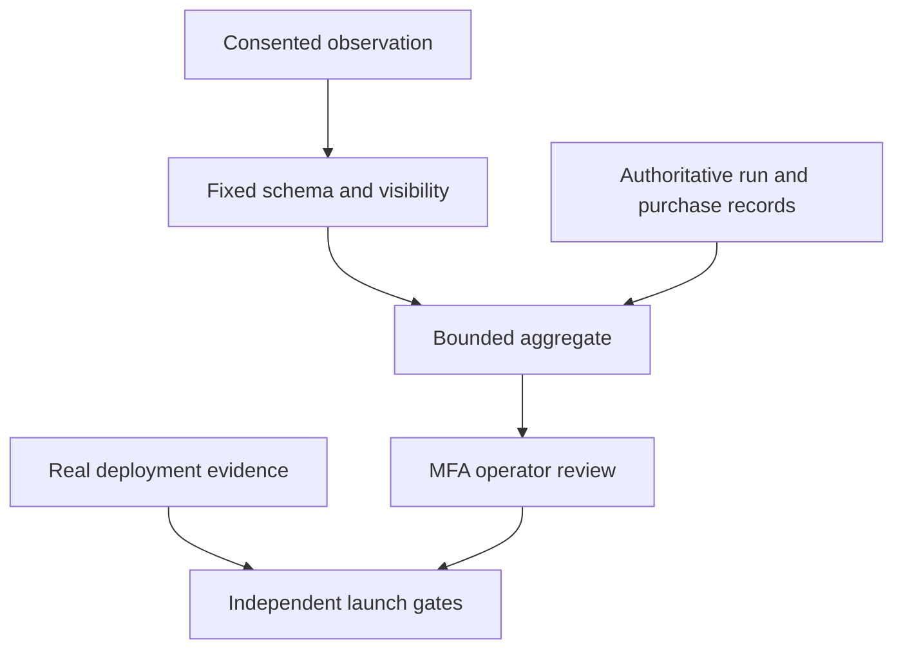

# V5.2 CEO review — HOLD scope

Decision: implement the accepted S08 phase on current main in the existing Java/PostgreSQL modular monolith. The user's instruction authorizes the full phase and merge; deployment prerequisites remain independently evaluated, never invented.

## Premise and approaches
The product gap is evidence and operational control, not another platform. Reuse the 24 component releases, 18 native labs, authenticated admin/MFA, analytics consent, transactionally fenced admissions, source entitlements, existing restore verifier and Spectral design system.

| Approach | Effort | Risk | Reuse / consequence |
|---|---|---|---|
| Extend existing domains (recommended) | One phase | Bounded query/event overhead | Current auth, retention, admissions, UI and CI; complete accepted scope |
| Separate telemetry/operations services | Several phases | New data copies, auth and deployment boundaries | Some existing producers; unnecessary for current measured traffic |

Chosen approach follows the authorized full phase with existing architecture. No new service, broker, analytics vendor or runtime activation is proposed. Twelve-month ideal: observed cohorts and evidence-driven capacity changes; do not turn proposed thresholds into guarantees.

## Eleven review sections
1. Architecture: versioned bounded observation schemas, aggregates behind admin with current MFA; feature gates do not bypass certification or payment readiness.
2. Errors: invalid event -> 400/no persistence; inaccessible artifact -> 404; stale MFA -> existing 403; database outage -> explicit unavailable; monitor timeout -> outage sample; malformed/incomplete evidence -> unmet gate; budget denial -> separate admission denominator. No success fallback.
3. Security: no input, token, query, email or URL payload in new telemetry. Browser observations never assert authoritative purchases or infrastructure success. No public operational counters, worker credentials or protected bytes.
4. Data flow: empty cohort yields null rate; duplicate observation has idempotent identity; missing runtime evidence is unmet; upstream outage counts as failure; stale evidence cannot authorize activation.
5. Code quality: small domain extensions and stdlib scripts, additive migrations, no generic workflow engine; preserve existing money/account authority.
6. Tests: PostgreSQL negative authorization/privacy/denominator tests, content clean reproduction, evidence rejection controls, responsive/keyboard/browser checks, full prior regressions and final-head CI.
7. Observability: fixed event vocabulary, explicit mode/version/window/denominators; quota, stale worker and orphan alerts; structured logs exclude payloads.
8. Database/state: bounded retention and indexed aggregate windows; immutable source hashes and observed run states; no restoring capabilities or rewriting financial history.
9. API: authenticated typed operations snapshot; optional consented browser events; source/run authority derived by server. No arbitrary callback, metrics public dump or lifecycle mutation added by telemetry.
10. Performance: declare 10k eligible/20 req/s catalogue test profile and hardware; startup separately from queue. Real seven-day monitoring records outages. 10x growth uses indexes/caps; 100x requires measurements, not a millions claim.
11. UX: Spectral tokens, visible status/text denominators, 44px controls, error focus and refresh, 320/390/768/1024/1440 widths, reduced motion; sample mode permanently labelled and mutations disabled.

Strongest decisions: retain existing authority; exclude replay/sample from live denominators; fail closed on incomplete deployment evidence. Accepted: all eight S08 items. Deferred/excluded: new services, arbitrary execution, GPUs, physical hardware, teams/payout expansion, vendor analytics. Blocking deployment evidence is recorded in the launch ledger, separate from software verification. Real time cannot be replaced with a fabricated seven-day fixture.
